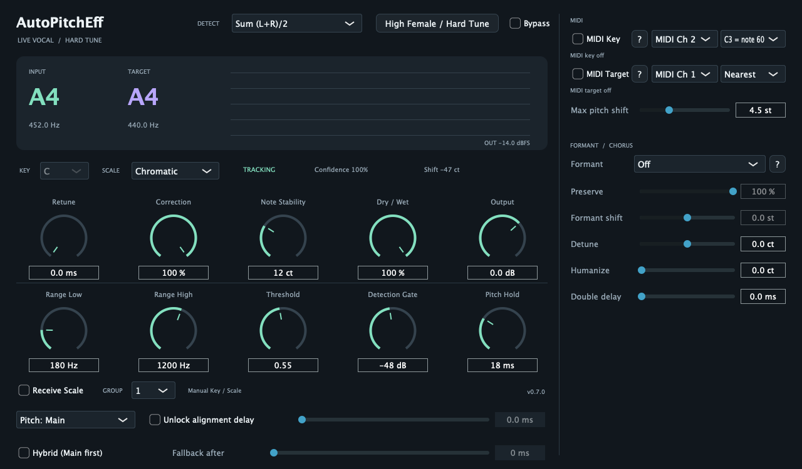
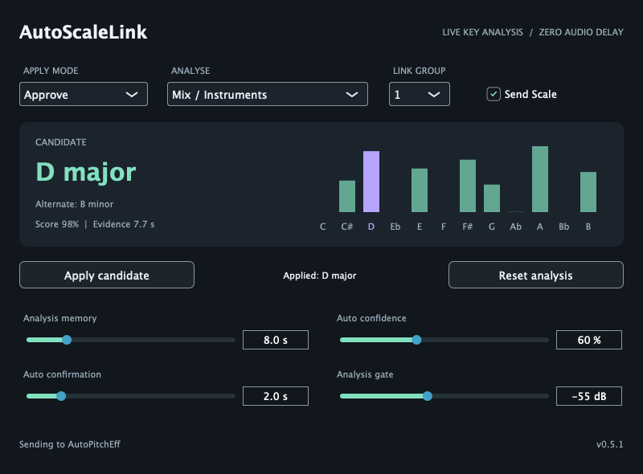

# AutoPitchEff / AutoScaleLink

ライブ歌唱向けの低遅延ピッチ補正 VST3 プラグイン（macOS、Apple Silicon / Intel 両対応）と、曲の調を自動で解析して AutoPitchEff に送る相棒プラグインです。

*English summary: Low-latency live vocal pitch correction (VST3, macOS universal) with MIDI key/target control, zero-latency formant preservation and chorus tools, plus AutoScaleLink, a companion plug-in that detects the song key and sends it to AutoPitchEff. AGPL-3.0. Documentation is in Japanese.*



| プラグイン | できること |
|---|---|
| **AutoPitchEff** | 歌声の音程を、指定したスケール（または全半音）の最寄りの音へリアルタイムに補正します。ハードチューン（いわゆるケロケロ声）から自然な補正まで。MIDI でキーや目標の音程を指定したり、フォルマントを保ったままハモリ・コーラスを作ることもできます |
| **AutoScaleLink** | 伴奏や歌声から曲の調（キー）を解析し、AutoPitchEff のスケールを自動で切り替えます。音は加工せずそのまま通します |

声の音高を揃えるエフェクトです。声質そのものを別人やボーカロイドに変える音声合成ではありません。

---

## 1. インストール

### 配布 ZIP から（ビルド不要）

1. [Releases](../../releases) から `AutoPitchEff-<版>-macOS-universal.zip` をダウンロードして展開します。
2. `AutoPitchEff.vst3` と `AutoScaleLink.vst3` を `~/Library/Audio/Plug-Ins/VST3/` へコピーします（Finder で `Cmd + Shift + G` → このパスを入力）。
3. **ターミナルで次を実行します**（理由は下記）。

   ```bash
   xattr -dr com.apple.quarantine ~/Library/Audio/Plug-Ins/VST3/AutoPitchEff.vst3 ~/Library/Audio/Plug-Ins/VST3/AutoScaleLink.vst3
   ```

4. DAW を起動し、プラグインを再スキャンします（Cubase: スタジオ → VST プラグインマネージャー）。

> **なぜ 3. が必要？** このプラグインは Apple の有料開発者署名・公証（notarization）を受けていません（ビルド時に「アドホック署名」だけを付けています）。インターネットからダウンロードしたファイルには macOS が「隔離（quarantine）」の印を付け、公証のないプラグインは DAW での読み込みを拒否されます。上のコマンドは、その印だけを外します。プラグインの中身は変更しません。信頼できる入手元のファイルにだけ実行してください。

### ソースからビルド

Xcode Command Line Tools、CMake 3.22 以上、Ninja が必要です（例: `brew install cmake ninja`）。JUCE 8.0.12 はビルド時に自動でダウンロードされ、ハッシュで検証されます。

```bash
./scripts/build-macos.sh     # ビルド + テスト（初回は JUCE 取得のため数分）
./scripts/install-macos.sh   # ~/Library/Audio/Plug-Ins/VST3 へインストール（既存版は退避）
```

自分でビルドしたものは隔離の印が付かないため、上記の `xattr` は不要です。

## 2. まず使ってみる（Cubase の例）

1. マイク入力のオーディオトラック（モノラル推奨。ステレオも可）のインサートに **AutoPitchEff** を挿し、モニターを有効にします。
2. 右上の **High Female / Hard Tune** を押すと初期設定になります（Chromatic＝全半音、Retune 0 ms、Correction 100%、Dry/Wet 100%）。これだけで、歌った音が最寄りの半音へ強く補正されます。
3. 曲のキーが分かるなら **KEY / SCALE** を設定すると、そのスケールの音だけに補正されます。
4. 自然な補正にしたい場合は **Retune** を 20〜60 ms に上げます（0 ms が最も機械的）。
5. 音が途切れる場合はオーディオバッファーを増やします（まず 48 kHz / 64 samples から）。

男性や低い声では **Range Low** を下げてください（初期値 180 Hz は高めの声向け）。

各ノブ・ボタンにカーソルを合わせると説明が表示されます。`?` ボタンには詳しい使い方があります。

## 3. 機能

### 3.1 補正の基本パラメーター

| パラメーター | 用途 |
|---|---|
| Retune | 目標の音程へ近づく速さ。0 ms でハードチューン。全体の遅延ではありません |
| Correction | 補正量。100% で目標の音程まで補正 |
| Note Stability | 音符の切り替わりにくさ（初期 12 cents）。補正先の音がパタパタ変わるなら 20〜30 へ |
| Dry / Wet、Output | 原音との混合率と出力ゲイン |
| Range Low / High | 音程を検出する範囲（初期 180〜1200 Hz）。歌う最低音より少し低く |
| Threshold | 周期性の検出閾値。声なのに途切れる場合は 0.45 程度へ下げる。楽器を拾う場合は上げる |
| Detection Gate | この音量未満では検出しない（出力を消すゲートではありません） |
| Pitch Hold | 検出が一瞬途切れたときに前の音を保持する時間 |
| KEY / SCALE | Chromatic（全半音）、Major、Minor |
| DETECT | ステレオ入力時の検出元（L+R / Left / Right）。補正は左右共通にかかります |

### 3.2 AutoScaleLink：キーの自動解析・連携

1. 曲全体（または伴奏バス）に **AutoScaleLink** を挿し、ANALYSE を **Mix / Instruments** にします。歌声だけを解析する場合は、ボーカルトラックの AutoPitchEff の前に挿して **Vocal** にします。
2. 両方の **GROUP** を同じ番号（初期 1）にし、AutoPitchEff の **Receive Scale** をオンにします。
3. 初期設定の **Approve** では、表示された候補を確認して **Apply candidate** を押したときだけ反映します。**Automatic** では、十分な確信度で一定時間安定した候補を自動で反映します（まずはリハーサルで Approve を推奨）。
4. 解析バーをクリックすると、その音を主音にした調を直接選べます。

調の判定には数秒の演奏が必要です。対応は 12 長調と 12 自然短調です。和声的短音階や旋法が多い曲では、手動設定の方が適する場合があります。



### 3.3 MIDI Key：MIDI ノートでスケールを切り替える

画面右の **MIDI Key** をオンにし、MIDI トラックの出力を AutoPitchEff に送ります（既定 Ch 2）。DAW のオクターブ表記（C3 = 60 / C4 = 60）を右のメニューで合わせてください。

| ノート | 動作 |
|---|---|
| C0〜B0 | メジャーキーを指定（C0 = C メジャー / A マイナー、D0 = D メジャー / B マイナー…）。転調の位置で次のキーを送る |
| C1〜B1 | その音を「使える音」に追加 |
| C2 | 使える音をリセット。独自の音階は C2 の直後に C1〜B1 で好きな音を送る |

キー指定と追加は組み合わせられます（例: C0 と G#1 を同時に送る → C メジャー + G#）。使える音が空の間は手動の KEY / SCALE（または AutoScaleLink）を使います。

### 3.4 MIDI Target：MIDI ノートで目標の音程を直接指定する

**MIDI Target** をオンにすると、指定チャンネル（既定 Ch 1）で押さえているノートの音程へ補正します（スケール設定より優先）。ノートを全部離すと通常のスケール補正に戻ります。

- **Nearest**（既定）: ノートの音名を、歌声に一番近いオクターブで使います。メロディを何オクターブで弾いても同じです。
- **Absolute**: 弾いたノートの高さそのものが目標です（歌う高さで弾く）。
- **Max pitch shift**（1〜12 半音、既定 4.5）が補正幅の上限です。ハモリを作るときは上げてください。

### 3.5 フォルマント保持とコーラス

大きく音程を変えると、普通は声の響き（フォルマント）も一緒に動き、上げると子供っぽい声、下げると太い声になります。**FORMANT** で、遅延を増やさずに元の響きを保てます。

| 項目 | 内容 |
|---|---|
| Formant | `Off`／`LPC`（低めの声で最も正確・軽い）／`True Envelope`（高い声向け、CPU は約 3 倍）／`Auto`（F0 500 Hz で自動切り替え）。切り替え時に一瞬音が途切れるので、停止中に変更してください |
| Preserve | 元の響きをどれだけ保つか（100% で完全に保持、0% で Off と同じ） |
| Formant shift | 響きだけを ±12 半音動かす（+ で小柄・明るい声、− で大柄・暗い声） |
| Detune | 補正後の音程を一定量ずらす（±50 セント） |
| Humanize | ゆっくりした不規則な音程の揺れ（重ねた声どうしの干渉を防ぐ） |
| Double delay | 補正後の音だけを遅らせる（0〜50 ms、ダブリング効果） |

**コーラスの作り方の例**：元の歌をハモリの数だけ別トラックに送り、それぞれに AutoPitchEff を挿して MIDI Target でハモリの旋律を指定します。設定例: Dry/Wet 100%、Retune 20〜60 ms、Max pitch shift 12、Formant Auto、Formant shift を声ごとに少し変える（+1.5 / −1.5 など）、Detune ±5〜12 ct、Humanize 3〜8 ct、Double delay 10〜30 ms。

### 3.6 サイドチェインで音程を検出する（上級者向け）

周りの音が大きくて音程検出が乱れる場合、ボーカル抽出プラグインなどで取り出したきれいな歌声をサイドチェインに入れ、そちらで検出してメイン音声を補正できます（抽出機能自体は内蔵していません）。

1. 元の音声を分岐し、一方を AutoPitchEff のメインへ、もう一方を抽出プラグイン経由で AutoPitchEff のサイドチェインへ送ります。
2. **Pitch: Sidechain** を選びます。**Hybrid (Main first)** をオンにすると、普段はメインで検出し、検出できない間だけサイドチェインを使います（切り替えまでの時間は **Fallback after**）。
3. 抽出側がメインより遅れて届く場合は、停止中に **Unlock alignment delay** をオンにして、メインを待たせる時間（0〜50 ms）を設定します。この時間は DAW へ遅延として報告されます。まず 0 ms で試し、実際にずれている分だけを設定してください（DAW が既に揃えている場合に二重補正になるため）。

## 4. 遅延と限界

- DAW へ報告する固定遅延は 8 サンプル（48 kHz で約 0.17 ms）です。これに、音程・補正量に応じて変わる読み出し遅延（おおむね 1 周期以内）が加わります。オーディオバッファーやインターフェースの遅延は別です。
- 音程の検出と補正先の音の決定には、数十 ms の追従時間があります（初期設定で半音の移動に約 40 ms）。
- マイクに入った音全体を処理するため、大きな楽器音・残響・雑音があると誤検出やうなりが出ることがあります。
- フォルマント保持の精度は合成音で測定しています（下記資料）。実際の歌声での聴感評価は、利用環境で確認してください。
- 市販製品と同等以上の精度は実証していません。

## 5. 開発者向け

```bash
./scripts/build-macos.sh                      # Release universal ビルド + ctest
./scripts/package-macos.sh                    # 配布 ZIP（dist/）を作成
cmake --preset dsp-debug && cmake --build --preset dsp-debug && ctest --preset dsp-debug   # DSP のみ、ASan/UBSan
```

| ディレクトリ | 内容 |
|---|---|
| `Source/dsp` | 音程検出・ピッチシフト・フォルマント処理・MIDI スケール（JUCE 非依存） |
| `Source/key` | AutoScaleLink の調解析とプラグイン間連携 |
| `Source` | AutoPitchEff のプラグイン本体と画面 |
| `Tests`、`Tools` | 単体テスト、プラグインの状態・ホスト検査、評価スクリプト（Python + NumPy） |
| `docs/research` | 技術調査と設計（[ピッチ補正](docs/research/2026-09-05-live-vocal-pitch-correction.md)、[調の自動解析](docs/research/auto-scale.md)、[フォルマント保持](docs/research/2026-10-14-formant-preservation.md)） |
| `docs/validation` | 初期版の測定結果 |

## 6. ライセンス

AGPL-3.0-only（[LICENSE](LICENSE)）。JUCE などの依存関係は [THIRD_PARTY.md](THIRD_PARTY.md) を参照してください。Auto-Tune・Waves などの製品のコードやモデルは含みません。
