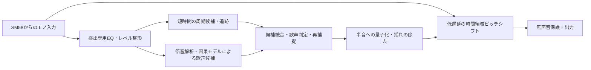

# ライブ用ボーカル・ピッチ補正：技術調査と実装方針

調査日：2026-09-05。公開製品資料、原論文、開発元のソースコードを調査した。以下の数値は「資料に記載された値」「数式からの計算値」「今後の開発目標」を区別している。本プロジェクトでの音声処理・性能測定はまだ実施していない。

## 1. 今回の結論と使用条件

最も適した方針は、**歌声のピッチを推定する経路と、実際に声を加工する経路を分けた構成**である。加工経路には時間領域の低遅延ピッチシフター、推定経路には短時間の周期追跡と、楽器の回り込みに対応する歌声ピッチ候補の選別を組み合わせる。

「混合音から歌声のF0（基本周波数）を直接推定する」研究が今回の中心になる。出力音をきれいに分離する処理は必須にしない。女性の高めの音域、近接マイクで声が比較的大きいという条件は有利だが、公開論文だけから実際のライブでの達成精度は確定できない。

開発時に想定した使用環境：

| 項目 | 条件 |
|---|---|
| ホスト | Cubase 13 |
| マイク | Shure SM58、ボーカル用の1本 |
| オーディオインターフェース | Behringer UMC204HD |
| 開発・主な使用機 | M4 MacBook Air |
| 配布形式 | macOS arm64 / x86_64 両対応 VST3 |
| 声 | 女性ボーカル、高め。低音域はあまり使わない |
| 操作 | MIDIや歌メロの音程指定なしで、自動補正 |
| 音作り | 音程の揺れが少なく、音符の切り替わりが明確なボーカロイド風 |
| 回り込み | 声が比較的大きい。混ざった楽器音も多少加工されることは許容 |
| 優先順位 | ピッチ追従の安定性、演奏できる低遅延、強い補正。出力分離は追加候補 |

「ボーカロイド風」はまずハードチューンとして実現する。声質・発音まで特定の歌声合成エンジンに置換するボイスチェンジャーとは、実装範囲を分ける。

## 2. 既存製品から確認できたこと

| 製品・資料 | 公開されている遅延と仕様 | 取り入れる点 |
|---|---|---|
| Waves Tune Real-Time | 説明書ではホストへの報告は0、検出・補正による実際の遅延は音程依存で0〜4 ms。ポリフォニック入力は非対応 | 音程依存の遅延、音域の限定、補正速度と音符間遷移の分離 |
| AutoTune 2026 | 48 kHzのLow LatencyでModernは112 samples ≒2.33 ms、Classicは37 samples ≒0.77 ms。HQはフォルマント補正の品質を優先 | ライブ向け経路を設け、音質処理の追加コストを選択可能にする |
| Auto-Tune ProのTracking説明 | ソロの声や単音楽器の周期的波形を前提とする。Trackingは周期性に対する許容度を変える | 「周期がある」と「歌声である」を別に判定する必要がある |
| Graillon | 開発元の旧版マニュアルでは44.1 kHzで1074 samples ≒24.3 ms。Graillon 3紹介記事は2から遅延が同じと説明 | 「リアルタイム」「Live」と書かれていても5 ms以内とは限らない |

出典：[Waves説明書 p.5](https://assets.wavescdn.com/pdf/plugins/tune-real-time-v16-update.pdf)、[AutoTune 2026説明書 p.16](https://antares-web-frontend.sfo3.cdn.digitaloceanspaces.com/documentation/pdfs/AutoTune_2026_User_Guide.pdf)、[Auto-Tune Tracking解説](https://help.antarestech.com/hc/en-us/articles/41115327742740-What-does-the-Tracking-knob-and-other-controls-do-in-Auto-Tune-Pro)、[Graillon説明書](https://www.auburnsounds.com/downloads/Graillon%20User%20Manual.pdf)、[Graillon 3開発元記事](https://www.auburnsounds.com/blog/Introducing-Graillon-3.html)。版・モード・サンプルレートが異なる数値を、同一条件の実測比較としては扱わない。

現行AutoTuneとWavesの内部アルゴリズム全体は公開資料からは特定できない。特に「WavesはこのPSOLA実装」「現行AutoTuneはこのニューラルネット」と断定する根拠は確認できなかった。

一方、初期Auto-Tuneに関係するHildebrandの公開特許には、自己相関に基づく周期検出、逐次更新、周期の補間、目標音程との比率による再サンプリング、周期に合わせた読み出し位置の調整が記載されている。**過去の周期を継続的に追跡し、既にある波形を利用して加工する**考え方は、今回の時間領域エンジンの参考になる。ただし、これは現行製品の実装を証明する資料ではない。[US5973252A・技術記載](https://patents.google.com/patent/US5973252A/en)

なお、AutoTuneの別の公式ブログには「2.5 ms / 175 samples at 44.1 kHz」という換算の不整合がある。175 / 44100は約3.97 msなので、今回の比較には上記ユーザーガイドの値を採用した。[該当公式ブログ](https://www.antarestech.com/fr/blog/real-time-pitch-correction-for-live-performance-with-autotune-2026)

## 3. 「0 ms」をどう扱うか

遅延は少なくとも次の4つに分ける。

| 指標 | 意味 | 今回の扱い |
|---|---|---|
| 音声経路の遅延 | 入力の発音・音量変化が加工出力に現れるまで | ライブモードは追加2〜5 msを最初の開発目標とする。達成値ではない |
| ピッチ認識・捕捉時間 | 歌い出しや音程跳躍後、正しいF0に追いつくまで | 音声経路とは別に測定する |
| 補正の追従時間 | 認識した音程を目標音へ移す速さ | ハードチューンでは極短くする。0設定でも認識時間は残る |
| システム往復遅延 | A/D、USB、入出力バッファ、プラグイン、D/A等の合計 | UMC204HDとCubaseで実測する |

例えば過去24 msの信号を解析しながら、出力の固定バッファを3 msにする設計は可能である。ただし解析結果は過去の信号を含み、歌い出し・跳躍への反応は3 msになるとは限らない。過去窓の右端に時刻を付けるだけでは、情報の古さは解消しない。

周期長の計算は次のとおり。

| F0 | 1周期 | 3周期 |
|---:|---:|---:|
| 180 Hz | 5.56 ms | 16.67 ms |
| 220 Hz | 4.55 ms | 13.64 ms |
| 440 Hz | 2.27 ms | 6.82 ms |
| 880 Hz | 1.14 ms | 3.41 ms |

高い声では短い窓に複数周期が入るため有利である。ただし「F0推定には物理法則として必ず3周期必要」という意味ではない。既知の波形モデル、倍音、過去の推定を使えば短時間でも推定できる一方、雑音下・初回捕捉・急変時の確実性は下がる。

48 kHzの64 samplesは片道1.33 ms、入出力のバッファを単純に足すと2.67 ms。32 samplesならそれぞれ0.67 / 1.33 msである。これは計算上のバッファ部分で、UMC204HDの実際の往復遅延ではない。

周波数領域処理も、一律に「FFT窓長ぶん出力が遅れる」とは限らない。解析窓と合成窓を分ける設計がある。ただし普通のSTFTライブラリの窓を短く設定するだけで、その設計になるわけではない。

## 4. ピッチ検出技術の比較

### 4.1 まず作るDSP基盤

**YIN / 正規化自己相関 / MPM系**は、短い時間窓で周期候補を出す基盤に適する。YINは差分関数と正規化等で周期の誤りを減らす手法で、低コストな追跡器として有用。ただし単音の周期検出だけでは、ギターやベースを歌声と取り違える可能性がある。[YIN原論文](https://pubmed.ncbi.nlm.nih.gov/12002874/)、[YIN・MPM等のC++実装](https://github.com/sevagh/pitch-detection)

採用案は、最初から1個のF0に決めず、上位候補と信頼度を持つこと。短い窓は現在の変化を捉え、長めの窓はオクターブと周期の整合性を確認する。追跡が安定しているときだけ、前回F0付近の局所探索で計算量と応答時間を減らす。

**SWIPE / RT-SWIPE**は、倍音配置とスペクトル形状を照合する候補である。2025年のRT-SWIPEは過去側の窓を用いるリアルタイム化と、応答遅延を考慮した評価を扱う。吹奏楽・アンサンブルが中心の検証なので、女性歌声とバンドの回り込みに対する性能は別途確認する。[RT-SWIPE著者公開資料](https://zenodo.org/records/17496631)

取り入れるのは、最大ピークを選ぶ方法ではなく、複数倍音の整合性を評価する考え方。実装の丸ごと採用は、窓と計算コストを確認してから判断する。

### 4.2 学習モデルは「速い」と「未来を見ない」を分けて選ぶ

| 手法 | 今回の価値 | そのままライブに使う際の問題 | 判断 |
|---|---|---|---|
| CREPE / torchcrepe | 波形からF0を推定する比較基準 | 公式CREPEは16 kHz・1024 samples＝64 msの入力。既定の中心窓と系列復号にも注意 | 精度比較用。tinyにしても入力時間幅は短くならない |
| PENN | F0と周期性・無声音判定を評価する基準 | フレームの窓・中心化・Viterbi等の復号に応答遅延がある | 信頼度設計と比較用 |
| RMVPE | 伴奏を含む音から直接ボーカルF0を抽出する、今回に合う研究目的 | 双方向GRUと時間方向の畳み込み・階層化。未来文脈を使う | オフライン比較・教師候補として優先 |
| FCPE | 軽量な文脈処理と雑音拡張学習が参考になる | 公開実装に両側畳み込み、時間方向を含むGroupNorm等がある | 因果モデルを設計する参考。無改造での採用はしない |

出典：[CREPE論文](https://arxiv.org/abs/1802.06182)、[CREPE公式実装](https://raw.githubusercontent.com/marl/crepe/master/crepe/core.py)、[PENN論文](https://arxiv.org/abs/2301.12258)、[PENN実装・復号の説明](https://github.com/interactiveaudiolab/penn)、[RMVPE論文](https://arxiv.org/pdf/2306.15412)、[FCPE論文](https://arxiv.org/html/2509.15140v1)。

RMVPE原論文の設定は16 kHz、2048 samplesの窓（128 ms）、20 ms hopで、双方向GRUを用いる。一般に見かける派生版と原著実装では設定が違う場合があるため、「RMVPEの遅延は常に何ms」とは固定しない。今回確認した原著コードでも`bidirectional=True`を確認できた。[原著の系列処理](https://raw.githubusercontent.com/Dream-High/RMVPE/main/src/seq.py)、[原著モデル](https://raw.githubusercontent.com/Dream-High/RMVPE/main/src/model.py)

FCPE論文はMIR-1KでRPA 96.79%、RTX 4090でRTF 0.0062を報告している。このRTFは処理速度の指標で、6.2 msの音声遅延やM4での性能を意味しない。また、白色・有色雑音への強さを、そのまま歪んだギターや別の歌声への強さと解釈しない。[FCPE論文の実験](https://arxiv.org/html/2509.15140v1)

実装を確認すると、FCPEの入力部は時間に対するカーネル3・両側パディングの畳み込みとGroupNormを含む。バックボーンにもsame paddingがある。GroupNormは入力形状がB,C,TならT方向も統計に含むため、畳み込みを左側パディングへ変えるだけでは因果化は完了しない。フレームごとの正規化、時間キャッシュ、再学習が必要になる。[FCPE models.py](https://raw.githubusercontent.com/CNChTu/FCPE/main/torchfcpe/models.py)、[FCPEバックボーン](https://raw.githubusercontent.com/CNChTu/FCPE/main/torchfcpe/model_conformer_naive.py)

**本命は、歌声F0候補の分類を行う小型の因果モデルを、短時間DSP追跡器と組み合わせる方式。** 因果モデルとは、出力時点までに受け取った音だけを使うモデルである。既存非因果モデルを小さなチャンクで繰り返し実行しても、境界の推定精度や学習時との違いは残る。

RMVPE等の結果を教師として利用する場合も、教師の誤りを正解扱いしない。クリーン歌声の信頼できるF0と照合し、曖昧な部分を除外する。歌声の種類・曲・伴奏を分けたテストが必要である。

## 5. ユーザーの提案をどう取り入れるか

### 帯域カット：採用。ただし検出経路に限定して比較する

最初のプリセット候補は、F0探索を180〜1200 Hz程度に置く。これは性別から決まる範囲ではなく、今回の「高めで低音が少ない」という条件に対する仮設定である。実際の最低音と最高音に合わせて変更できるようにし、外れた際に強い倍音へロックしない仕組みを入れる。

検出前のHPFは例えば100〜140 Hz、LPFは4〜6 kHz付近から実験する。**F0の探索範囲と、検出入力に残す周波数帯域は別物**である。探索上限1200 Hzだから1200 Hzでローパスすると、声の判別に使う上位倍音が消えてしまう。

IIRを第一候補とし、群遅延と位相変化も評価する。EQした信号だけに依存せず、軽く整えた広帯域信号と比較する。高音ほど帯域内に含まれる倍音の本数が減るので、固定の狭帯域フィルターは避ける。

### 最大の周期・最大の倍音列：候補生成として採用

最大の周期成分が必ず声とは限らない。ギター、ベース、鍵盤にも明確な倍音列がある。候補ごとに、正規化周期性、複数倍音の一致、隣接倍音間の間隔、信号の時間変化、歌声確率を組み合わせる。

強い第2倍音をF0とする誤りと、複数音の共通部分を低いF0とみなす誤りの両方を検査する。候補f、2f、f/2を比較し、単純な最強ピーク選択を避ける。

### フォルマント・声らしさ：補助特徴として採用

スペクトル包絡、傾斜、倍音ごとの相対強度、時間変化を特徴にする。特定のフォルマント周波数に一致したら声、といった固定規則にはしない。高い女性歌声では倍音間隔が広く、包絡やフォルマントを細かく推定しにくい。LPCによる白色化も比較対象だが、混合音では楽器側に引かれる可能性がある。

歌声の有無と周期性を分けることが重要である。長く伸びたギターは高い周期性を持つが、それは歌声の証拠にはならない。

### 音声分離：検出精度を上げる場合のみ追加

まずは波形を再構成せず、スペクトル上の歌声の重み付けや、直接F0候補を出す処理を優先する。波形の分離品質よりも「正しい歌声F0が選べるか」を最適化する。

通常の音源分離を音声経路に直列追加すると遅延が増える例がある。HS-TasNetは23 ms、Band-SCNetは92 msという設定で音楽分離を報告しており、そのまま2〜5 msの経路には入らない。これらは分離品質の比較や学習用候補になる。[HS-TasNet](https://arxiv.org/html/2402.17701v1)、[Band-SCNet原論文](https://www.isca-archive.org/interspeech_2025/yang25d_interspeech.pdf)

一方、MERL等の研究には長い解析窓と短い合成窓を組み合わせ、音声強調を4 ms、未来フレーム予測を加えて2 msにする結果がある。単一マイクの検証も含む。ただし16 kHzの雑音・残響を含む話声の研究であり、48 kHzの歌声・バンド分離性能を示すものではない。将来の拡張候補として有望だが、今回の必須経路からは外す。[MERL公開論文・§V、Tables I–IV](https://www.merl.com/publications/docs/TR2022-166.pdf)

RNNoiseも比較可能だが、既定モデルは話声強調を目的としており、歌のブレス・裏声・ビブラートを保つ前提にはしない。[RNNoise開発元](https://github.com/xiph/rnnoise)

## 6. 推奨する処理構成

以下は本プロジェクトの設計提案であり、既存製品の内部を示すものではない。



### 6.1 推定は速い追跡と安定した選別を組み合わせる

初期比較パラメータ：

| 項目 | 実験の開始点。確定仕様ではない |
|---|---|
| 音声経路 | 48 kHz |
| 検出経路 | 16 kHzまたは24 kHzも比較。リサンプリング遅延を計上 |
| 速い周期解析 | 過去8〜16 ms程度。音域下端では長い窓の助けを使う |
| 倍音・候補選別 | 過去24〜48 ms程度から比較 |
| 推定更新 | 1〜2 ms程度。ホストブロックとは独立に刻む |
| 推定結果 | F0候補、声の有無、信頼度、対象時刻、結果の経過時間 |
| 追跡途絶時 | 短時間だけ保持・予測し、声の証拠が続かなければ滑らかに補正解除 |

長い窓の推定をそのまま現在の音に適用しない。長い窓は声／楽器の選択とオクターブの安定化を助け、現在の細かい音程変化は短時間の追跡器で更新する。双方が食い違ったら、局所探索から全域再捕捉へ切り替える。

音声スレッドから待たない補助推論を使う場合、結果に時刻を付け、古すぎる結果を捨てる。非同期化は音声出力を止めにくくするが、推定の反応を速くするわけではない。最終的に必要な小型モデルは、処理時間が保証できる専用C++推論器も比較する。

### 6.2 曲の音程を指定しない場合の補正

初期値は**Chromatic、A=440 Hz、全12音へ自動量子化**とする。歌メロのMIDI入力も、曲ごとの音符指定も不要にする。

```text
入力音高 m = 69 + 12 log2(F0 / 440)
目標音高 q = hysteretic_round(m)
目標F0 = 440 × 2^((q - 69) / 12)
シフト比 r = 目標F0 / 推定した入力F0
```

境界付近では小さなヒステリシスを入れて隣の半音との往復を防ぐ。ただし強すぎる音符保持は本当の跳躍を遅らせるので、歌い出し・音量変化・F0変化量に応じて解除する。

出力の揺れを除去するには、目標音高を固定しつつ、入力F0の細かい変化に合わせてシフト比を更新する。F0やシフト比を長時間平均してしまうと、元のビブラートが出力に残る。目標の安定化と入力の瞬時追跡は別に設計する。

Chromaticは「歌った音に近い半音」への補正である。歌った音から50 cents以上離れた意図した音符や、曲の正解メロディーは、声だけから確実には分からない。ユーザーの入力指定なしの条件では、これは仕様上の限界として扱う。任意のKey/Scale機能を追加しても、既定動作の必須条件にはしない。

### 6.3 「認識が落ちると効果が消える」問題の扱い

有声／無声の単一しきい値で補正を即座にON/OFFしない。短い不確実区間では、例えば10〜20 msを初期比較値としてF0を保持・予測する。声の証拠がなくなった状態で保持を続けると、楽器や息に前の音程を付けてしまうので、長い途絶では徐々に解除する。

表示には「声を検出」「追跡中」「一時保持」「再捕捉」を設け、入力音程・目標音程・補正量を確認できるようにする。単なる「感度を上げる」調整だけに依存させない。

## 7. ピッチシフトの方式

### 第一候補：周期を利用する時間領域方式

過去の波形をリングバッファに保持し、補間付き読み出しとクロスフェードで持続時間を維持しながら周波数を変える。検出した周期を使って読み出しの接続位置を合わせる。周期同期OLA、相関による接続点選択、可変遅延の考え方を比較する。[初期公開特許](https://patents.google.com/patent/US5973252A/en)、[DAFx 2007・相関を利用したリアルタイムピッチシフト](https://dafx.labri.fr/main/papers/p007.pdf)

これは「一般的なPSOLAを置けば必ず0〜5 msになる」という提案ではない。対称な粒の切り出しや未来のピッチマークを待つ実装は、複数周期ぶんの遅延を持ちうる。過去側の波形利用と接続方法を明示的に設計する。

今回の通常用途は半音への補正なので、正しい音符選択後のシフト幅は多くの場合小さい。大幅な移調を最初から同一品質で実現するより、短い遅延でハードチューンを成立させる条件を先に評価する。

弱点は、誤った周期での接続、音の立ち上がり、子音、歌の急変である。位相を連続させ、クリックを防ぎ、必要に応じて接続幅を変える。ピッチ変更を含む処理は時変なので、単一インパルスだけでは実効遅延を表せない。

### 第二候補：周波数領域方式

位相を管理するSTFT系の方式は音質比較に使う。高品質ライブラリの例としてSignalsmith Stretchがあるが、確認した標準プリセットは100〜120 ms規模のブロックを設定し、入出力遅延を別々に取得する設計である。標準設定を今回のライブ経路へそのまま入れる方針にはしない。[Signalsmithの説明](https://signalsmith-audio.com/code/stretch/)、[プリセット・遅延APIのソース](https://raw.githubusercontent.com/Signalsmith-Audio/signalsmith-stretch/main/signalsmith-stretch.h)

ブロックを小さくした場合の品質・実効遅延は測定対象であり、「このライブラリでは低遅延が不可能」とまでは結論しない。

### 音色処理

まずRetune相当を最速、ビブラート保持を0、Humanize相当を0、補正量100%とする。初期段階で強い声質置換は加えない。小幅のピッチ補正が成立した後に、フォルマント保持／移動を追加して機械的な声の質感を調整する。

LPCやスペクトル包絡によるフォルマント制御は候補だが、高い歌声と回り込みで不安定になる場合を検証する。子音・ブレスなどF0を持たない部分に音程を無理に付けず、遅延を合わせた非補正成分を使って明瞭さを保つ。

ニューラル再合成には低計算量のFARGAN等もあるが、話声での結果や小さい生成単位だけでは、歌声・特徴抽出を含む低遅延を保証しない。今回の第一実装には入れない。[FARGAN原論文](https://arxiv.org/abs/2405.21069)

## 8. Mac ARM / IntelのVST3実装

実装基盤はC++ / JUCE / CMakeを第一候補とする。音声DSPをプラグインUIから分離して、ファイル入力の評価用実行形式でも同じDSPを使えるようにする。CubaseのネイティブApple Silicon動作では、Apple Silicon対応またはUniversal BinaryのVST3が必要である。[Steinberg互換性資料](https://helpcenter.steinberg.de/hc/en-us/articles/32056309094290-Cubase-Nuendo-Using-the-native-Apple-Silicon-version)、[JUCE](https://github.com/juce-framework/JUCE)、[VST3 SDK](https://github.com/steinbergmedia/vst3sdk)

| 要素 | 方針 |
|---|---|
| バイナリ | arm64 / x86_64を含むUniversal Binary。依存ライブラリも両対応 |
| サンプルレート | 48 kHzを先行。44.1 / 96 kHzは段階的に検証 |
| チャンネル | モノ入力・モノ出力を最初の対象とする |
| 音声処理 | メモリを事前確保。コールバックでロック、ファイルI/O、モデルロードを行わない |
| 推論 | 初期比較はONNX Runtime CPU。最終経路は必要に応じ固定形状の専用実装 |
| 高速化 | CPU SIMDを先行。GPU / ANEは起動・転送・スケジューリングを含む最悪時間で比較 |
| モデル切替 | 音声スレッド外で準備し、安全に切替 |
| 遅延通知 | 固定バッファを正しくホストへ報告。変動成分と認識応答は別に公開 |
| 状態保存 | 音域、補正速度、量子化、音色、検出調整を保存 |
| Intel確認 | クロスビルドとRosetta確認に加え、Intel実機で性能を検証 |

ONNX Runtimeの公式資料には`CMAKE_OSX_ARCHITECTURES="x86_64;arm64"`による両対応ビルドが記載されている。ただしUniversal Binaryができることと、Intelでも同じバッファで安定することは別である。[ONNX Runtime・macOSビルド](https://onnxruntime.ai/docs/build/inferencing.html)

M4の計算性能は選択肢を広げるが、解析に必要な音声が届くまでの時間は短縮しない。CPU平均使用率だけで判断せず、音声コールバックごとの処理時間、推論結果の古さ、長時間負荷で評価する。

依存の条件は採用時の版を固定して記録する。確認した公開リポジトリの表示は、FCPEがMIT、RMVPEがApache-2.0、VST3 SDKがMIT、JUCEのモジュールがAGPLv3またはJUCEライセンスである。学習済み重み・学習データはコードと別に確認する。今回、製品のバイナリや非公開コードは利用していない。[FCPE](https://github.com/CNChTu/FCPE)、[RMVPE](https://github.com/Dream-High/RMVPE)、[VST3 SDKの条件](https://github.com/steinbergmedia/vst3sdk#license--usage-guidelines)、[JUCEの条件](https://raw.githubusercontent.com/juce-framework/JUCE/master/LICENSE.md)

## 9. 精度を高めるためのデータと検証

「最高水準」は単一データセットの順位では決めない。今回のマイク音・音域・ライブ用途で、既存製品より追従しやすいかを比較する。

### データ

クリーンな女性歌声と、ドラム・ベース・歪んだギター・鍵盤等の独立した伴奏から、回り込みを模擬する。室内伝達、残響、SM58に近い周波数特性の変化、近接効果、破裂音、マイク距離の変化も加える。正確なマイク応答を測定していない段階では「SM58を忠実再現」とは呼ばない。

歌声対伴奏比は+20 / +10 / +5 / 0 / −5 dBを比較する。これは有声区間での声と伴奏のエネルギー比として定義し、今回の主条件は声が優勢な+5〜+20 dB側とする。0 dB以下はストレス試験である。歌っていない区間も必ず含める。

特に、歌声とギターが同じ音、1オクターブ違い、半音違い、ユニゾンから離れる場面を含める。白色雑音だけで耐性を評価しない。原曲のテスト断片や同じ歌手が学習・評価へ漏れない分割を行う。

### 測定項目

| 測定 | 見たい失敗 |
|---|---|
| RPA・10/25 cents以内率 | F0自体の正確さ。RPAの一般的な±50 centsだけでは強い補正に粗い |
| オクターブ誤り率 | 2倍・半分のF0への誤追従 |
| 歌声の見逃し・誤検出 | 効果が消える区間、楽器へ効果を掛ける区間 |
| 他楽器への乗り移り回数／分 | 長く間違った音を追い続ける失敗 |
| 歌い出し・跳躍の捕捉時間 | 反応の鈍さ。失敗・タイムアウトも集計する |
| 出力F0の残留揺れ | ビブラートが消えるか、目標へ本当に張り付くか |
| 音符境界の不要な往復 | ハードチューンの意図しない細かい音符切替 |
| 発音・音量包絡の遅延 | 表示が0でも音が遅れていないか |
| コールバック最大時間・分位値 | 平均CPU負荷に現れない音切れ |
| 実機の往復遅延 | 実際に歌って使える応答か |

精度評価で出力を自由に時間移動して合わせると、遅い検出器が有利になる。実際の出力時刻での評価と、推定内容だけを見る遅延補正後の評価を両方出し、補正した時間も明示する。捕捉時間は有声開始／音程変化の基準を定義し、所定の誤差内が一定時間続くまでとして測る。[遅延を扱う評価の参考：RT-SWIPE](https://zenodo.org/records/17496631)

ピッチ変更後の音は入力と波形が違うため、単純相互相関だけを遅延の正解にしない。既知の包絡変調を持つ有声音、破裂音、急な母音変化、小幅の上下シフトを使って、包絡・発音・F0応答を分けて測る。

段階ごとの比較は、①広帯域の単独周期検出、②EQ追加、③倍音候補統合、④歌声確率モデル追加、⑤必要なら検出用強調、の順で行う。どの機能が実際に役立ったかを確認し、改善しない機能は常時経路に残さない。

### 開発の仮目標

初期目標は、ライブ音声経路の追加2〜5 ms、安定した有声区間で目標音程への誤差を小さく保つこと、+5〜+20 dBの伴奏混入で単独DSPよりオクターブ誤り・追跡途絶を減らすこととする。数値の精度保証は実音声の基準結果が取れてから設定する。

歌い出し・跳躍の捕捉は10〜30 ms程度を比較の出発点とし、音域と混入量別に実測する。これは音声出力をその時間ぶん必ず遅らせる設計でも、達成済みの性能でもない。

## 10. 実装順序

1. **比較・測定基盤**：音声をホスト相当のブロックで投入し、未来の音を参照できない評価器を作る。既存製品は使用可能な環境で同じ入力・音量・補正条件で録音比較する。
2. **DSP版VST3**：検出専用EQ、複数周期候補、音域設定、Chromatic量子化、低遅延ピッチシフター、無声音保護を実装する。まずクリーン歌声と声が優勢な混合音で成立させる。
3. **誤りの分析**：追跡途絶、オクターブ誤り、ギターへの乗り移り、歌い出しの遅れを分類する。単にしきい値を下げて通す調整はしない。
4. **因果モデルの追加**：必要な失敗に絞り、歌声確率・F0候補を出す小型モデルを学習し、DSPと統合する。非因果モデルは比較・教師用途に置く。
5. **音色と実機仕上げ**：残留ビブラート、クリック、子音、フォルマントを調整し、Cubase 13・M4とIntelで確認する。
6. **追加候補**：検出側の強調でまだ改善余地がある場合だけ、音声強調を比較する。出力の音源分離は最後の任意拡張とする。

最初から「完全分離→大型F0モデル→高品質汎用ピッチシフト」を直列に並べる構成は採らない。ユーザーが必要としている検出の安定性を、低遅延の経路で直接改善する。

## 11. Cubase / UMC204HDでの検証開始条件

SM58 → UMC204HDのマイク入力 → Cubaseのモノトラック → 本VST3 → 出力、の順にする。48 kHz / 64 samplesから試し、安定したら32 samplesを比較する。これは実機のドライバーが選択可能な範囲で行う初期案である。

エフェクト確認時はCubase経由の加工音を聴く。UMC204HDのダイレクトモニターは入力を直接返す経路なので、その音だけを聴いてもVST3は確認できない。Input/Playback MIXはPlayback側を基準にし、未加工音との混合によって効果が弱く聞こえないようにする。[Behringer製品資料・Input/Playbackとダイレクトモニターの説明](https://media.djmania.net/manuales/pdf/Manual_Behringer_UMC204HD.pdf)

長い遅延を持つ他のインサートやマスター処理を含まない測定用プロジェクトで、プラグイン単体とシステム全体を分けて記録する。SM58の距離・向き・ゲインも記録し、同じ条件で比較する。入力クリップがある場合はF0の誤りと区別する。

## 12. 今回確認した範囲

完了したのは、公開技術調査、主要F0実装の因果性確認、今回の使用条件に合わせた構成・評価・実装順の策定である。VST3バイナリ、学習済み独自モデル、実測の精度・遅延結果はまだない。

現行商用製品の非公開アルゴリズムの完全再現や、任意の混合音での完全追跡を保証できる根拠はない。一方、今回の「比較的大きく拾える高めの女性歌声」に対象を絞り、声の判別と周期追跡を分担させる方法は、実装・比較する価値のある方針である。
